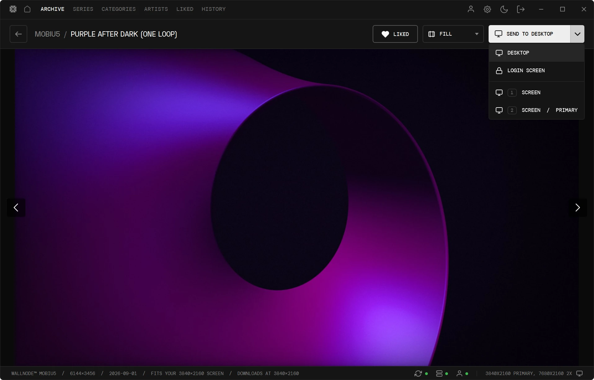
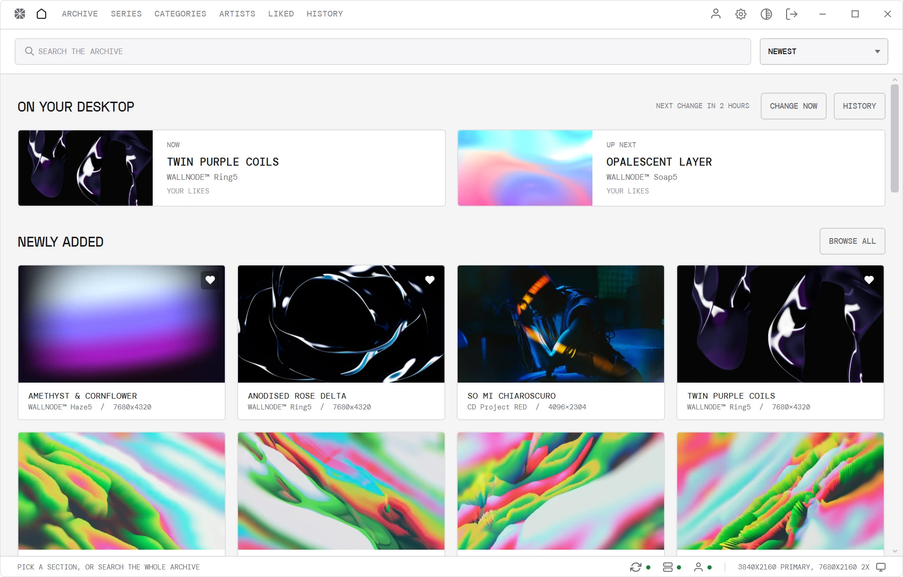
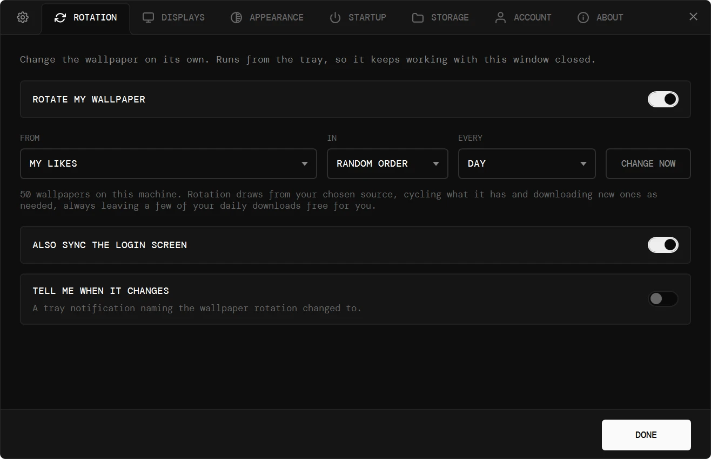
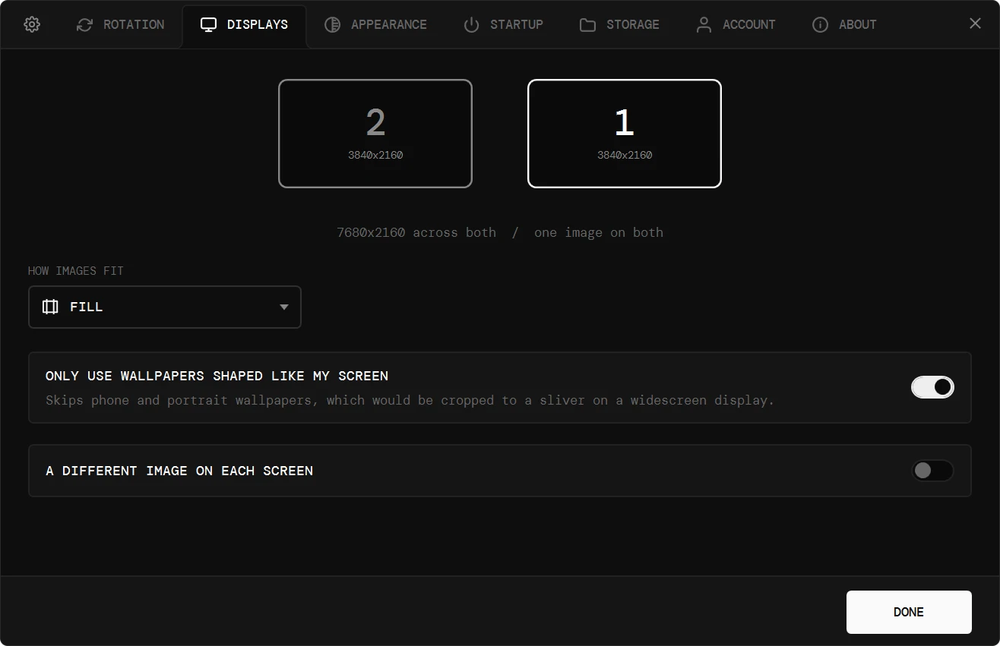

# WALLNODE desktop releases

Published builds of the WALLNODE desktop app for Windows. This repository holds
the installers and the changelog, nothing else. There is no source here.

**Download the current version from [wallnode.cc/app](https://wallnode.cc/app)**,
which also explains the SmartScreen warning and lists the SHA-256 to check
against.

Every release is attached to a tag on the [releases page](../../releases).

## What it is

Browse the [WALLNODE](https://wallnode.cc) archive from your desktop, set a
wallpaper at your screen's real resolution, and let it change itself on a
schedule from any series, category, artist, your likes or a search.

Windows 10 1809 or later, 64-bit. It installs for your account only, so there is
no administrator prompt, and it does not start with Windows unless you ask it to.

## Screenshots

  
  

## Not signed

The installer has no code-signing certificate, so Windows shows
"Windows protected your PC" the first time you run it: More info, then Run
anyway. That is SmartScreen saying it has not seen the file before, not that it
found anything wrong with it. Each release lists a SHA-256 if you would rather
check the file yourself.
